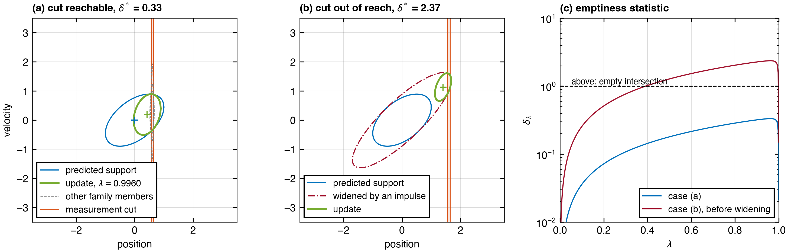
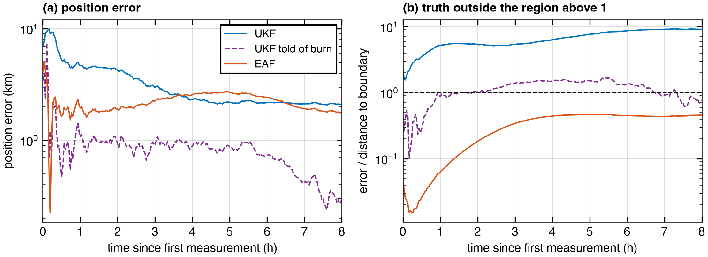
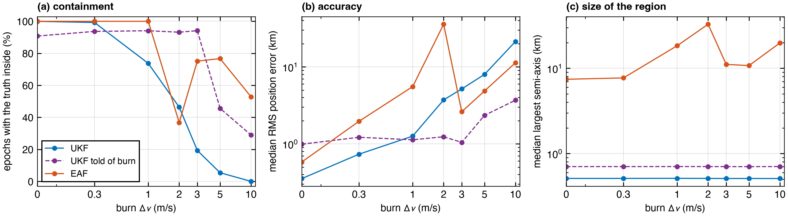
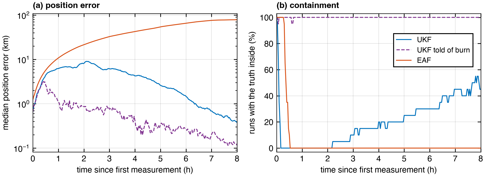

# The Epistemic Abductive Filter, by example

This repository explains the Epistemic Abductive Filter (EAF) of M. K. Jah
([Preprints 202610.2608](https://www.preprints.org/manuscript/202610.2608), 2026) with a small,
readable implementation and one orbit-tracking scenario. The scenario shows a situation in which the
EAF does something a Kalman-type filter cannot: it notices that its prior is wrong. Varying the same
scenario also shows where the filter reaches its limits.

The code is our reading of the preprint, not the author's implementation. Where the preprint leaves
a choice open, the choice is stated in the code, and any mistakes are ours. Corrections are welcome
as issues.

## The idea

A Kalman filter or UKF carries a Gaussian: a best guess and a covariance. If the prior is wrong, it
has no way to say so. It weighs the prior against the data and, with a confident prior, can stay
confidently wrong for a long time.

The EAF carries a set instead: a support ellipsoid E(c, P) that contains every state still
consistent with three declarations the user makes:

| | Declaration |
|---|---|
| D1 | the initial state lies in a stated ellipsoid |
| D2 | the unmodelled motion over each interval lies in a stated ellipsoid |
| D3 | each measurement error is at most ρ times a stated resolution |

A measurement then defines a cut, the set of states whose predicted measurement is within the
declared error of the observed one. The update intersects the support with the cut. The intersection
of two ellipsoids is not an ellipsoid, so the filter uses the one-parameter Schweppe family of
ellipsoids that contain it, and keeps the member of least volume. Its centre is the estimate.



*Figure 1. One EAF update with a two-dimensional state (position, velocity) and a position
measurement. (a) Support and cut overlap: the update (green) contains the overlap. (b) They do not
overlap: the filter widens the support with a velocity impulse until they do, then updates. (c) The
emptiness statistic δ_λ of the two cases; its maximum δ\* is above 1 exactly when the intersection
is empty.*

Two parts of the algorithm explain most of what follows.

- The emptiness test. If δ\* > 1, the support and the cut do not meet, so at least one declaration
  is false. The filter does not average the conflict away. It looks for the simplest explanation (the
  "abductive" step), which here is an unmodelled velocity impulse at some time since the last
  consistent measurement, and widens the support just enough to admit it. A Kalman filter has an
  innovation test too, but nothing in its update responds to it.
- The update is deliberately gentle. The tolerance ε = 0.002 limits the weight to λ ≥ (1 + ε)⁻² ≈
  0.996, and the least-volume member is almost always at that limit. The preprint reports this for
  99.5 % of its updates and notes that it gives up some of the information in the data. The support
  contracts quickly only when the cut is much narrower than the support. In Figure 1 the cut is 25
  times narrower. With a wider cut the update leaves the prior nearly as it was.

The third piece is a gate on ρ, the multiple of the sensor resolution that defines the cut. When the
predicted centre's residual falls outside the cut (a miss) but the test above does not fire, ρ grows by
a factor of 1.2. After a hit, it shrinks slowly back towards 1.

## The quiet-burn scenario

A geostationary satellite makes a manoeuvre that nobody announces. The catalogue still holds its
pre-burn state, which is now wrong by the burn. The next night a ground telescope picks the satellite
up again, and every filter has to start from the stale catalogue entry.

| | |
|---|---|
| Dynamics | two-body + J2 for truth and filters (no model error apart from the burn) |
| Satellite | GEO, circular, inclination 0.05°, 15° east of the site |
| Catalogue | 1 km per position axis, 0.1 m/s per velocity axis (1σ), drawn consistently with the pre-burn truth |
| Burn | Δv of fixed size in a random direction, right after the catalogue epoch |
| Gap | 12 h from the catalogue epoch to the first measurement |
| Sensor | one telescope at 32° N, topocentric right ascension and declination every 120 s for 8 h, errors N(0, 1″) truncated at 3σ |

The filters:

| Filter | Settings |
|---|---|
| UKF | α = 1, β = 2, κ = 0; R = (1″)² I; white acceleration noise of 1e-10 km/s² |
| UKF told of burn | the same UKF, but its velocity prior covers ±5 m/s (3σ). It knows that a burn may have happened. |
| EAF | preprint constants (ε = 0.002, gate α = 0.05 and gain 1.2, ρ₀ = 3, impulse 5 cm/s to 20 m/s). D1: the 99.73 % ellipsoid of the catalogue covariance. D2: a constant acceleration of at most 3e-10 km/s² per axis. D3: 3″ per angle. |

Every declaration of the EAF is true except D1, which the burn makes false. That is the situation
the EAF is built for.

## Where it works



*Figure 2. One run with a 3 m/s burn. (a) Position error. (b) Error divided by the distance from the
estimate to the boundary of the filter's region in the direction of the truth (the EAF support, or a
UKF's 99.73 % position ellipsoid). Above 1, the truth is outside.*

After 12 hours the stale prior is about 410 km from the truth. At the first measurement the EAF's
emptiness test fires (δ\* > 1), the filter widens its support with an impulse, and from then on the
truth is inside its region at every epoch. The UKF never has the truth inside its region during the
8 hours. Its error comes down to about 2 km, but it reports a region with a semi-axis of 0.5 km, so
it is confidently wrong all night. The UKF that was told of the burn is the most accurate, but it is
also overconfident for about 5 of the 8 hours.

| Filter (run of Figure 2) | RMS position error | epochs with the truth inside | median largest semi-axis |
|---|---|---|---|
| UKF | 3.63 km | 0 % | 0.52 km |
| UKF told of burn | 1.07 km | 35 % | 0.71 km |
| EAF | 2.26 km | 100 % | 7.25 km |

When the prior is wrong in a way the data contradict right away, the EAF notices, flags it, and
reports a region that still contains the truth. The cost is a region about 14 times larger than the
UKF's.

## How often it works

The scenario was run 20 times for each burn size from 0 to 10 m/s (`examples/sweep.py`).



*Figure 3. Twenty runs per burn size. (a) Epochs with the truth inside the region. (b) Median RMS
position error. (c) Median largest position semi-axis of the region.*

Epochs with the truth inside (%), median RMS position error (km), and runs ending more than 5 km off
(of 20):

| Δv (m/s) | UKF | UKF told of burn | EAF | EAF runs that widened |
|---|---|---|---|---|
| 0 | 100 / 0.35 / 0 | 91 / 0.99 / 0 | 100 / 0.58 / 0 | 0 |
| 0.3 | 99 / 0.73 / 0 | 94 / 1.22 / 0 | 100 / 1.96 / 0 | 0 |
| 1 | 74 / 1.26 / 0 | 94 / 1.13 / 0 | 100 / 5.55 / 0 | 0 |
| 2 | 46 / 3.73 / 0 | 93 / 1.24 / 0 | 37 / 35.8 / 13 | 7 |
| 3 | 19 / 5.17 / 0 | 94 / 1.04 / 0 | 75 / 2.62 / 5 | 15 |
| 5 | 5 / 7.99 / 0 | 46 / 2.35 / 0 | 77 / 4.87 / 10 | 20 |
| 10 | 0 / 21.4 / 8 | 29 / 3.69 / 2 | 53 / 11.3 / 14 | 19 |

The UKF's containment falls steadily with the size of the burn, because it never notices the burn.
The EAF's containment is at least as good as the UKF's at every burn size except 2 m/s, but it is
less even from run to run. Most runs either recover, with the truth inside all night, or end tens to
hundreds of kilometres off. The next section looks at why.

## Limits

These results use the preprint's constants unchanged, together with our choices for the steps the
preprint leaves open (mainly how the widening impulse enters the support). The constants were not
tuned for angles-only tracking at GEO, and the author's implementation may behave differently. With
that caveat, the cases below follow from the two parts of the algorithm described above.

### 1. The prior is correct

With no burn, every filter keeps the truth, and the UKF is more accurate (0.35 km against 0.58 km)
with a region 15 times smaller. When the declarations are all true, a well-tuned Gaussian filter is
the better choice. The EAF pays off when a declaration turns out to be false.

### 2. The prior is wrong, but not wrong enough to refute

The emptiness test only fires if the predicted support misses the cut entirely. An angle measurement
constrains two directions only, so its cut is a thin cone along the line of sight. A support that is
wrong but long enough to reach across that cone somewhere passes the test even if the truth is far
outside it. Then two things go wrong together.

- The gate reads every miss as a sensor problem and grows ρ, which widens the cut. In one 2 m/s run,
  ρ grows from 3 to 150 over 8 hours, and the support is never questioned.
- The gentle update (λ ≈ 0.996) barely moves the centre, so the estimate coasts on the wrong orbit.

This is why 2 m/s is worse than 3 m/s in the table: at 2 m/s only 7 of 20 runs drift far enough in
12 hours to be refuted at the first measurement.

The clearest example is the same scenario without the 12-hour gap, so that the burn happens just
before tracking resumes. The error then grows gradually, from almost nothing, and is never decisive:



*Figure 4. Burn just before tracking starts, 3 m/s, 20 runs. (a) Median position error. (b) Share of
runs with the truth inside the region.*

| Δv (m/s), no gap | UKF | UKF told of burn | EAF |
|---|---|---|---|
| 0 | 100 / 0.49 / 0 | 100 / 0.72 / 0 | 100 / 1.12 / 0 |
| 1 | 67 / 1.74 / 0 | 100 / 0.92 / 0 | 31 / 14.5 / 20 |
| 3 | 20 / 5.62 / 0 | 100 / 1.02 / 0 | 5 / 50.9 / 20 |
| 10 | 6 / 22.3 / 0 | 98 / 1.48 / 0 | 2 / 213 / 20 |

Here the EAF widened in none of the 80 runs and lost every run with a burn, while the UKF slowly
recovers. Detecting a contradiction works well when the contradiction is sudden. When it builds up
gradually, there is nothing for the test to catch.

### 3. The prior is refuted, but the widened support is too large to linearise

At 10 m/s the first measurement is refuted, and the widening gives a support with a semi-axis of
several hundred kilometres that does contain the truth. From then on every declaration is true, so
in a linear problem the truth could never leave the support again. The extended EAF, however,
linearises the dynamics and the measurement about its centre, and over a region that large neither
is linear. In one run we traced, the truth leaves the support about two hours after the widening,
no later measurement is decisive, and case 2 takes over. In all, 14 of the 20 runs end more than 5 km
off. The preprint anticipates this and gives a linearisation indicator (its eq. 10). Here it peaks at
about 0.2, above its threshold of 0.1, but it does so in the runs that recover as well, so it warns
of the risk without singling out the runs that fail.

### 4. A filter that is told is better

When it is known that a burn may have happened, a UKF with a wider velocity prior is more accurate
than the EAF at every burn of 0.3 m/s or more, with a region 11 to 47 times smaller. Its region is not
fully honest either: here a 12-hour Gaussian prediction from a ±5 m/s prior is curved enough to make
it overconfident at 6 to 71 % of epochs. The EAF's advantage is for the case nobody announced.

## Summary

| Situation | Better choice |
|---|---|
| Prior and models are right | UKF or EKF |
| A known event (manoeuvre, breakup) may have happened | Gaussian filter with a prior that covers it |
| Prior silently wrong, and the first data contradict it decisively | EAF: it detects the conflict and keeps the truth inside its region |
| Prior silently wrong, but the contradiction builds up slowly | neither; the EAF coasts, the UKF recovers slowly |
| A refuted prior leaves a support too large for linearisation | neither is reliable |

The way we read it, the EAF is best thought of as a detector and a record of what is still possible,
not as a more accurate replacement for a Kalman filter. It is worth using when a confidently wrong
answer is costly and the errors to guard against are abrupt.

## Notes on the implementation

- The support grows by a factor of up to (1 + ε) per prediction step. Predicting across the
  12-hour gap in 360 steps of 120 s makes it about twice as large on each axis as a single step would.
  This probably helps the EAF keep the truth at 1 m/s without widening.
- The preprint does not say how the widening impulse enters the support. Here it is an extra velocity
  uncertainty at the last consistent epoch, mapped forward by the state transition matrix.
- If even a 20 m/s impulse cannot explain the data, the support is doubled until it can. This last
  resort is not in the preprint.
- `tests/test_filter.py` checks the Kalman form of the update (Corollary 3 of the preprint), that
  every Schweppe member contains the intersection, and the emptiness test.

## Running it

Python 3.10 or later.

```bash
python -m venv .venv && source .venv/bin/activate
pip install -r requirements.txt
python examples/geometry.py          # Figure 1
python examples/quiet_burn.py 3 1    # one run, the run of Figure 2
python examples/sweep.py             # Monte Carlo, about 10 minutes on 10 cores
python examples/make_figures.py      # Figures 2-4
python -m pytest tests               # needs pytest
```

| File | Content |
|---|---|
| `eaf/filter.py` | the EAF: Schweppe family, emptiness test, widening, least-volume update, gate |
| `eaf/ukf.py` | the UKF baseline |
| `eaf/orbit.py` | two-body + J2 dynamics and state transition matrix |
| `eaf/sensor.py` | the telescope: topocentric right ascension and declination |
| `examples/quiet_burn.py` | the scenario and the run loop |
| `examples/sweep.py`, `examples/make_figures.py`, `examples/geometry.py` | Monte Carlo and figures |
| `results/` | Monte Carlo output (`sweep.json`, `curves.npz`) |

## Reference

M. K. Jah, "The Epistemic Abductive Filter: Closed-Form Possibilistic Estimation, Its Optimality, and
Its Kalman Form," Preprints 202610.2608, 2026.
